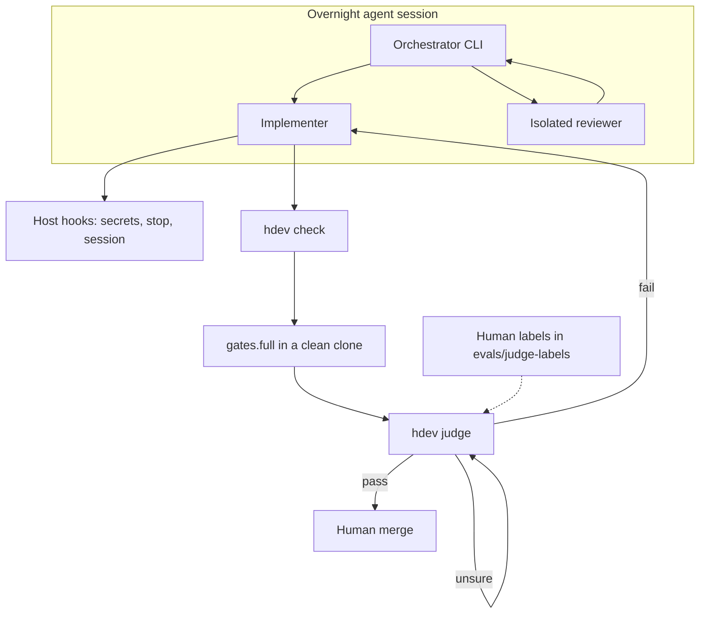

# hdev

**A Python harness where an LLM judge gates merges of coding-agent work.**

Overnight agent sessions write code. `hdev` is the local control plane that
keeps that work inside a spec, a plan, and a **hard merge gate**: another
model, from another provider, has to pass the diff before a unit of work
closes. The operator still merges. The judge does not get a GitHub token.

This repository is the harness itself (CLI `hdev`, hooks, skills, evals). It
grew next to a homelab agent host; host paths and credentials are **not** in
the tree. Point them at your machine with env vars (see `.env.example`).

## Why

Coding agents can run for hours. What they cannot do, unsupervised, is decide
that a change is done. Humans drown in the volume. `hdev` splits the job:

- **Agents implement** against a written spec and a TDD plan.
- **Host hooks** block secrets, destructive shell, and “stop” while a unit is
  still open.
- **`hdev check`** enforces complexity caps (prompt size, hook count, skills).
- **`hdev fechar`** runs the full test suite in a clean clone of `HEAD`.
- **`hdev judge`** packs the plan, the diff from a marked base, and the
  evidence, then asks a **different provider** than the executor: pass / fail /
  unsure. Fail does not fall through to the fallback. Unsure does.

The point is overnight sessions that produce **reviewable, rejectable units**,
not a chatbot that pushes to `main`.

## Architecture



Roles (see `.hdev/config.json`):

| Role | Default CLI | Default model | Job |
| --- | --- | --- | --- |
| Planner / executor | `claude` | Opus-class | Spec, plan, implementation |
| Isolated review | `grok` | grok-4.7 | Goldfish spec/diff review |
| **Judge** | `grok` | grok-4.7 | Merge gate (must not share the executor's provider) |
| Judge fallback | `codex` | GPT-class | Only on unsure / missing CLI |
| Typed gate (optional) | TypeSafe Jev | `jev-latest` | Route / risk / “ask a human?” — degrades if the key is missing |

## How to run

Requires Python 3.11+. Stdlib only for the harness. Optional: `pytest` for the
same suite CI runs. LLM CLIs (`claude`, `grok`, `codex`) are needed for live
judge/review, **not** for the unit tests.

```bash
git clone <this-repo> && cd harness-dev
python3 -m pytest          # CI suite; LLM calls are stubbed
python3 bin/hdev check     # complexity caps, no network
python3 scripts/lint.py    # tiny stdlib linter
```

Live judge (needs a signed-in `grok` or `codex` CLI, **not** an API key in the
repo):

```bash
cp .env.example .env       # then edit; never commit .env
python3 bin/hdev base --plan work/<id>/plan.md --marcar
python3 bin/hdev judge --plan work/<id>/plan.md --run-tests
python3 bin/hdev fechar --plan work/<id>/plan.md
```

Install into another repo as a pinned release: `python3 bin/hdev init <path>`.
Consumer projects get a `.harnessdev` symlink and a lockfile, not a copy of
this tree.

## How the judge is calibrated

The judge is **consultative until there are 20 valid human labels**, then it
becomes the hard gate (`LABELS_NEEDED` in `hdev/gates/judge/constants.py`).
This tree ships 22 labels in `evals/judge-labels/`.

Each label is one JSON object: plan id, run id, the judge's verdict, the
operator's expected verdict, and a short note. Labels are counted unique per
`(plan, run)`. Invalid or duplicate files do not count.

What the calibration is **not**:

- It is not a trained reward model. There is no fine-tuning (project decision).
- It is not a majority vote over many samples of the same prompt. One call,
  then fallback on unsure.
- Human notes record agreement and known false unsure/fail. The judge still
  hallucinates rationale; the mechanical pack (diff, tests, evidence paths)
  is the part that is deterministic.

Tests never call a live LLM. `tests/fixtures/fake_judge.py` is the stub
`hdev judge` uses in CI.

## Limitations

- Portuguese-first CLI and docs. New identifiers are English (ADR 0011).
- Designed around **subscription CLIs**, not paid API keys in the repo. If
  `grok` / `codex` / `claude` are not on `PATH`, the judge degrades; tests
  still pass.
- Homelab integration (account wrappers, area isolation, app chips) is
  optional and env-driven. A laptop clone should run the suite with no extra
  services.
- LLM-as-judge is noisy. That is why labels exist, why fail does not retry
  on the fallback, and why `--override` is an explicit operator act.
- Not a hosted SaaS. Not a replacement for code review of security-sensitive
  diffs. The secret hook is a regex guard, not a vault.
- Eval “real runner” (`--runner claude`) talks to a live agent; do not enable
  that in GitHub Actions.

## Honest note on authorship

This codebase was **co-written with coding agents** (Claude, Codex, Grok)
**under this harness**. The operator wrote the gates, the caps, the judge
pack, and the labels, and merged only what the judge (or an explicit
override) allowed. Treat it as an engineered loop, not as a dump of
unreviewed model output.

## License

MIT. See `LICENSE`.

## Suggested GitHub topics

See `docs/github-topics.md`.
